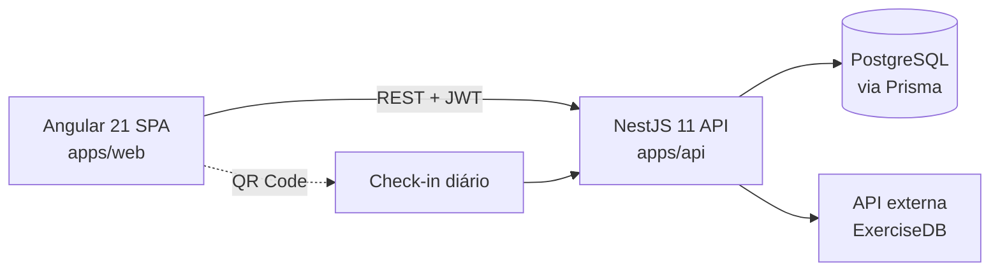

# SIGA — Sistema Integrado de Gestão de Academia

[](https://github.com/VictorTavaresRafael/siga-app/actions/workflows/ci.yml)

Aplicação full stack para a gestão da academia do câmpus da UTFPR: autenticação JWT, controle de acesso por perfil, check-in diário por QR Code, gestão de alunos e treinos, notificações e painel analítico com exportação CSV.

Trabalho de Conclusão de Curso em Engenharia de Software (UTFPR, Cornélio Procópio), aprovado em 09/07/2026 e **indicado pela banca como trabalho destaque** para prêmios e concursos de TCC.

## Stack

| Camada | Tecnologias |
| --- | --- |
| Front-end (`apps/web`) | Angular 21 (standalone components), Angular Material, RxJS, Chart.js |
| Back-end (`apps/api`) | NestJS 11, Prisma ORM, PostgreSQL, Passport JWT, Swagger |
| Segurança | bcrypt, Helmet, rate limiting (express-rate-limit), validação com class-validator |
| Qualidade | Testes de serviço com `node:test`, CI no GitHub Actions (build + testes) |

## Arquitetura



## Funcionalidades

- Login com JWT e segregação por perfil (`ADMIN`, `STUDENT`).
- Check-in diário por QR Code (código no formato `SIGA-YYYY-MM-DD`).
- Gestão de alunos: cadastro, atualização, perfil e desativação.
- Gestão de treinos por aluno, com exercícios estruturados.
- Painel analítico com séries temporais e exportação CSV.
- Canal de notificações aluno → administração, com resposta.
- Consulta assistida de exercícios via API externa.

## Como executar localmente

Pré-requisitos: Node.js 20 e PostgreSQL.

### 1) API (`apps/api`)

```bash
cd apps/api
npm install
cp .env.example .env   # ajuste DATABASE_URL e JWT_SECRET
npx prisma migrate dev
npx prisma db seed
npm run start:dev
```

API: `http://localhost:3333` · Swagger: `http://localhost:3333/api`

### 2) Web (`apps/web`)

```bash
cd apps/web
npm install
npm start
```

Web: `http://localhost:4200`

### Testes

```bash
cd apps/api
npm test
```

## Credenciais de seed (somente ambiente local)

Criadas por `npx prisma db seed` no seu banco local:

- Admin: `admin@siga.com.br` / `siga123`
- Aluno de exemplo: `aluno1@siga.com.br` / `siga123`

## Documentação detalhada

- Back-end: [`apps/api/README.md`](apps/api/README.md)
- Front-end: [`apps/web/README.md`](apps/web/README.md)

## Autor

Víctor Matheus Tavares Rafael · [LinkedIn](https://www.linkedin.com/in/victor-tavares-rafael-a13846236/) · [GitHub](https://github.com/VictorTavaresRafael)
